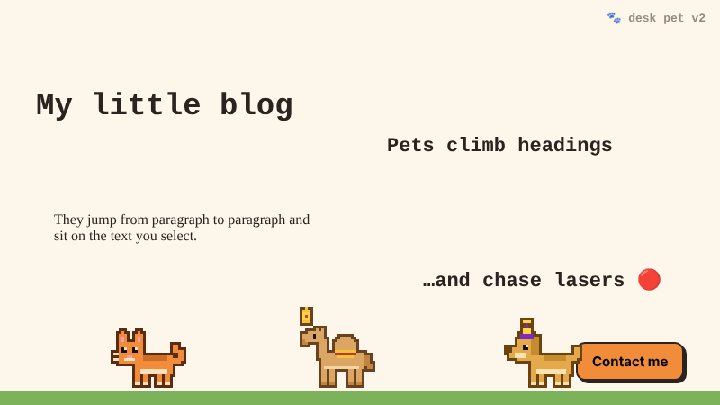

<div align="center">

# 🐾 Desk Pet

**A tiny pixel pet that lives on your website. One line of code.**

It walks around, naps when nobody's looking, chases your cursor and loves being petted.

### [▶ Adopt yours, with a live demo](https://sahil-zaini.github.io/desk-pet/)



</div>

---

## Add it to your site

Paste this just before `</body>`:

```html
<script src="https://sahil-zaini.github.io/desk-pet/pet.js" data-pet="cat" defer></script>
```

That's it. To choose a pet, colour and name in a few clicks, use the **[adopt page](https://sahil-zaini.github.io/desk-pet/)**.

## Pets

| Pet | `data-pet` | `data-color` |
|---|---|---|
| 🐈 Cat | `cat` | `ginger` · `black` · `white` · `grey` |
| 🐪 Camel | `camel` | `sand` (it comes with a little saddle blanket) |
| 🐕 Dog | `dog` | `brown` · `golden` · `husky` |

## Options

| Attribute | What it does | Default |
|---|---|---|
| `data-pet` | `cat`, `camel` or `dog` | `cat` |
| `data-color` | colour, see the table above | first colour |
| `data-name` | the name shown when you hover over the pet | — |
| `data-size` | pixel scale, from `1` to `5` | `3` |
| `data-say` | your own lines, separated by `\|`, e.g. `Welcome!\|Check out my work` | built-in lines |
| `data-bottom` | lifts the pet N pixels, e.g. above a cookie bar | `0` |
| `data-credit` | `false` hides the small "get your own" link in the hover card | shown |

```html
<script src="https://sahil-zaini.github.io/desk-pet/pet.js"
        data-pet="camel"
        data-name="Habibi"
        data-say="Marhaba!|Yalla, explore my site!"
        defer></script>
```

### JavaScript API

```js
DeskPet.spawn({ pet: "dog", color: "husky", name: "Rex", size: 4 });  // add another pet
DeskPet.removeAll();                                                  // send them all home
```

## What it does

- 🚶 Wanders along the bottom of the page.
- 💖 Click it for hearts and a happy jump.
- ✋ Drag it anywhere and let go. It drops back to the floor.
- 👀 Walks over to see when your cursor comes near.
- 😴 After 30 seconds with no activity it curls up and sleeps, and wakes up when you come close.
- 💬 Says little things now and then.
- ⤴ Double-click it to make it jump.

## Polite by design

- **Tiny:** one ~20 KB script with no dependencies. The pets are drawn in code, with no image files.
- **Isolated:** it runs inside Shadow DOM, so it never touches your styles and your styles never break it.
- **Never in the way:** only the pet itself catches clicks, and the rest of your page works normally.
- **Accessible:** visitors who prefer reduced motion get a calm pet that sits and naps.
- **Private:** no cookies, no tracking and no network calls.

## Install guides

<details><summary><b>WordPress</b></summary>

Install the free **WPCode** plugin → **Code Snippets → Header & Footer** → paste the code into **Footer** → **Save**.
</details>

<details><summary><b>Shopify</b></summary>

**Online Store → Themes → … → Edit code** → `layout/theme.liquid` → paste before `</body>` → **Save**.
</details>

<details><summary><b>Next.js</b></summary>

```jsx
import Script from "next/script";

<Script src="https://sahil-zaini.github.io/desk-pet/pet.js" data-pet="cat" strategy="afterInteractive" />
```
</details>

## Self-hosting

Download `pet.js`, put it on your own server and point the `src` there. It's MIT licensed.

## Ideas welcome

- [ ] More pets: falcon 🦅, owl 🦉, frog 🐸
- [ ] Seasonal hats 🎩🎄🌙
- [ ] Pets that meet and say hi to each other

Open an issue or a pull request, and a ⭐ helps others find it.

## License

MIT © Sahil Zaini

<sub>Designed &amp; Developed by Sahil Zaini / Zaini Developers · Powered by YCS Trust</sub>
